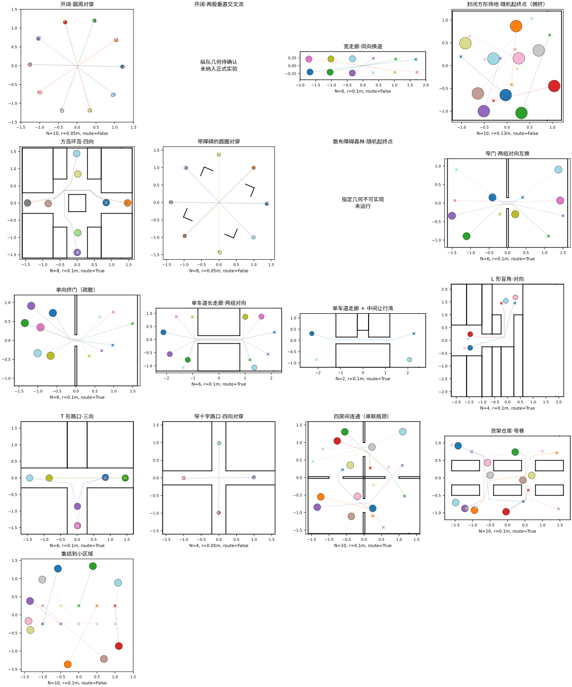
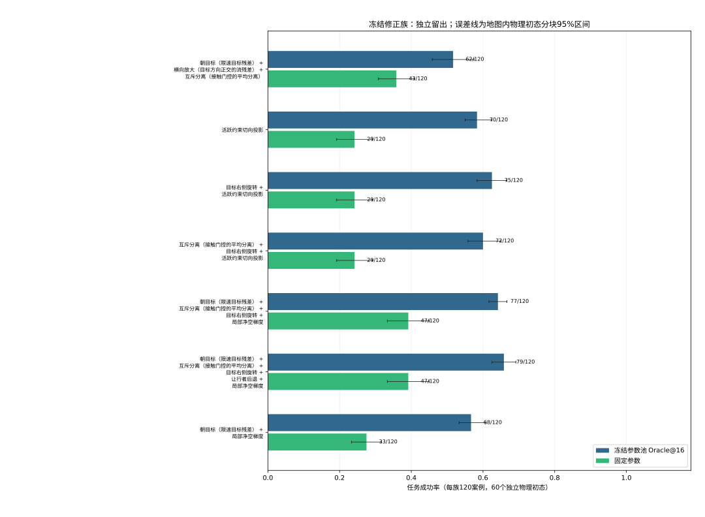
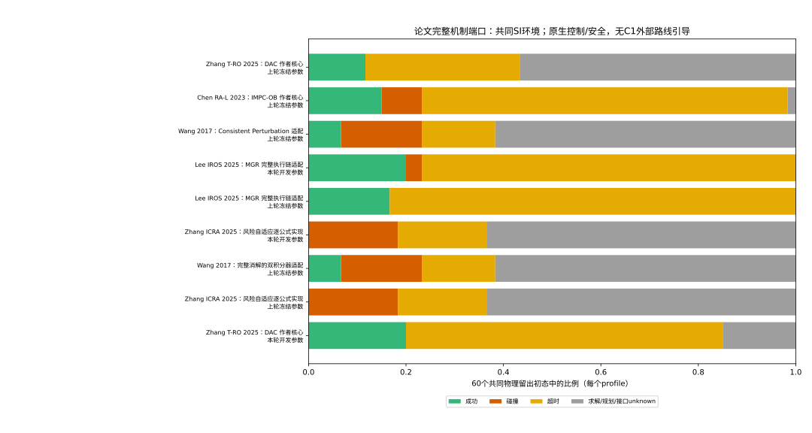

# 十七类场景上的修正基维度研究

按预登记规则推荐：4维，列为 朝目标（限速目标残差）、互斥分离（接触门控的平均分离）、目标右侧旋转、局部净空梯度。逐类留出 Oracle@16 对固定参数成功数：开阔·圆周对穿 8/8 对 8/8；开阔·两股垂直交叉流 N/A（几何或实现缺口）；宽走廊·同向换道 8/8 对 0/8；封闭方形场地·随机起终点（拥挤） 8/8 对 6/8；方岛环岛·四向 7/8 对 5/8；带障碍的圆圈对穿 8/8 对 3/8；散布障碍森林·随机起终点 N/A（几何或实现缺口）；窄门·两组对向互换 0/8 对 0/8；单向挤门（疏散） 1/8 对 0/8；单车道长走廊·两组对向 0/8 对 0/8；单车道走廊 + 中间让行湾 8/8 对 3/8；L 形盲角·对向 8/8 对 8/8；T 形路口·三向 8/8 对 8/8；窄十字路口·四向对穿 4/8 对 0/8；四房间连通（串联瓶颈） 1/8 对 0/8；货架仓库·窄巷 0/8 对 0/8；集结到小区域 8/8 对 6/8。覆盖缺口：开阔·两股垂直交叉流、散布障碍森林·随机起终点、窄门·两组对向互换、单向挤门（疏散）、单车道长走廊·两组对向、四房间连通（串联瓶颈）、货架仓库·窄巷。各维度最好族达到 6/8 的类型数：1维：7类；2维：8类；3维：7类；4维：9类；5维：10类。

所有结论限于已冻结、已执行的有限候选池。本轮可评估 15/17 类；开阔·两股垂直交叉流、散布障碍森林·随机起终点为明确缺口，不算控制失败。各可评估类型采用两个冻结名义控制器；每类仅4个独立物理初态，各控制器共享初态与随机流。推荐族固定点实际非零列为 朝目标（限速目标残差）、互斥分离（接触门控的平均分离）、目标右侧旋转；声明族维度不等于每个成功候选都用了全部列。交叉流旧横列原型被排除，未获确认的尺寸或半径提案没有执行。

重要参数域对照：原三列朝目标下界放宽到0后，补充Oracle@32为 72/120，在 9 类达到6/8，也达到主协议的 9 类门槛。预先冻结的新16点子池单独覆盖 67/120、够用 7 类，是另外的描述性子池结果。主协议的四维推荐只对应原参数盒和冻结Oracle@16，不能解释成“至少必须四维”；更小维数与更多候选／放宽参数域之间存在实际权衡。

## 场景、标定与五层证据

[完整标定](CALIBRATION.json)、[冻结场景与状态](SCENES_FROZEN.json)、[最终五层证据](FIVE_LAYER_FINAL.json)、[几何与安全边距](GEOMETRY_CONSISTENCY.json)。单机能力门均按 ≥95% 判断；未满足难度与 A* 见证条件的类型按最近档保留，仍明确记录未认证。成功 rollout 可补充构造性联合可解见证；超时不能推出死锁或不可解。

场景类型来源是几何与交通分类的移植，具体尺寸按本轮 prompt 新建，不是论文原地图复现。[17类场景卡、关键尺寸与逐类文献对应表](SCENE_CARDS.md)逐项说明来源与移植边界。圆周、交叉流、同向流、门、盲角与集结对应 [Francis 等场景清单](https://arxiv.org/abs/2306.16740)；森林的动机对应 [BARN](https://www.cs.utexas.edu/~xiao/BARN/BARN.html)，本轮森林几何被拒绝，没有运行 BARN 官方地图。

| 场景 | 冻结数量/半径 | 路线引导 | 安全基线成功 | A* 见证 |
|---|---|---|---|---|
|开阔·圆周对穿|10 / 0.05m|False|3/8|1/4|
|开阔·两股垂直交叉流|几何不成立|—|—|—|
|宽走廊·同向换道|6 / 0.1m|False|0/8|0/4|
|封闭方形场地·随机起终点（拥挤）|10 / 0.13m|False|4/8|3/4|
|方岛环岛·四向|8 / 0.1m|True|0/8|0/4|
|带障碍的圆圈对穿|8 / 0.05m|False|3/8|2/4|
|散布障碍森林·随机起终点|几何不成立|—|—|—|
|窄门·两组对向互换|6 / 0.1m|True|0/8|0/4|
|单向挤门（疏散）|6 / 0.1m|True|1/8|0/4|
|单车道长走廊·两组对向|6 / 0.1m|True|0/8|0/4|
|单车道走廊 + 中间让行湾|2 / 0.1m|True|5/8|0/4|
|L 形盲角·对向|4 / 0.1m|True|3/8|0/4|
|T 形路口·三向|6 / 0.1m|True|0/8|0/4|
|窄十字路口·四向对穿|4 / 0.05m|False|4/8|0/4|
|四房间连通（串联瓶颈）|10 / 0.1m|True|0/8|0/4|
|货架仓库·窄巷|10 / 0.1m|True|0/8|0/4|
|集结到小区域|10 / 0.1m|False|8/8|4/4|

路线接口异常共 17 条保存记录；其中 17/17 个异常机器人位置可用一段满足原可见性检查的短连接接回原路线图。这些诊断路径没有供给控制器，也没有改写 unknown。详见 [路线异常诊断](ROUTE_UNKNOWN_DIAGNOSTICS.json)。

森林排斥证据：每个 0.3m 方块向外膨胀 0.25m 后面积为 0.3²+4×0.3×0.25+π×0.25²；12 个的面积 7.03619m²，必须互不重叠且包含在 2.5m 方场地内，其面积仅 6.25m²。该矛盾与控制器无关。

## 场景描述与筛选证据

[描述量与距离矩阵](SCENE_DESCRIPTORS.json) 仅使用几何和初始路径。描述量不同不构成机制独立性的数学证明。[最小支持集](MINIMAL_SUPPORTS.json) 使用全部兼容成功见证，严格区分朝目标列存在时系数下界0.5、删除该列时系数为0的两个参数域；不把删除朝目标列的成功偷偷算入正下界家族。若没有一个合法家族覆盖两域全部已知见证，则明确记录有限池缺口，另保留最大合法覆盖比较族。必需列仅相对于本轮有限池。S4测试横向放大+互斥分离族，也是原三列系数朝目标=0的参数边界消融，不能把该类收益全归于新增空间方向。S1、S2、S3、S4 的候选清单、preflight、执行清单均保留；2,000局补搜和未找到成功不构成不可能性证明。

S4 的具体低维补搜规则见 [S4_SUPPORT_SELECTION.json](S4_SUPPORT_SELECTION.json)：用S1增量自动提名三个此前未单独测试的纯方向，再加原列零Goal域对照、一个父族删列子族和历史二维族，分配六族、2,000局。它不是对所有接近最大覆盖家族逐一做严格一列删除；该冻结前筛选启发限制了“每维最好”的搜索范围，未用留出结果修改。

### 搜索阶段实测

| 阶段 | 计划请求 | 唯一候选完成 | 成功候选 | 覆盖案例 | 新增覆盖案例 | unknown |
|---|---|---|---|---|---|---|
|S1|5520|5520/5520|1382|82|82|0|
|S2|3150|3150/3150|803|20|0|0|
|S3|4560|4560/4560|20|4|4|17|
|S4|2000|2000/2000|311|75|1|0|

[搜索阶段原始统计](SEARCH_STAGE_RESULTS.json)按现行有效场景统计，新增覆盖相对之前搜索阶段。单列共同中点控制见 [MATCHED_SINGLE_COLUMN_ATTRIBUTION.json](MATCHED_SINGLE_COLUMN_ATTRIBUTION.json)：原三列历史16点覆盖 60 个搜索案例，中点单独覆盖 32 个，中点本身新增 0 个。新增列的补救案例可重叠，不能直接相加。

| 新增列 | 原三列16点及共同中点均失败时新增成功案例 |
|---|---|
|目标右侧旋转|15|
|活跃约束切向投影|9|
|局部净空梯度|9|
|原始控制输出的横向残差|1|
|最紧一对的分离|4|
|冲突对旋转|4|
|按松弛加权的分离|0|
|群中心旋转|3|
|墙切向|1|
|让行者后退|4|
|让行者侧让|1|
|让行者离开通行者路线|4|
|让行者原地等待|0|
|让行者后退、通行者前进|4|
|通道轴向|3|

### 搜索集逐类最小支持与必需列

这里的最小支持覆盖该类型搜索集中所有已观测可成功案例，不是“留出达到6/8”的同一判据。零维表示不加线性修正已有见证；未找到单一家族时不声称这些列具有数学必需性。

| 场景 | 已覆盖搜索案例 | 有限见证最小维度 | 最小支持集（全称） | 所有最小支持共有列 |
|---|---|---|---|---|
|开阔·圆周对穿|8/8|1|目标右侧旋转；活跃约束切向投影|无共同列|
|开阔·两股垂直交叉流|N/A|N/A|几何或实现缺口|N/A|
|宽走廊·同向换道|8/8|2|朝目标（限速目标残差） + 局部净空梯度|朝目标（限速目标残差）、局部净空梯度|
|封闭方形场地·随机起终点（拥挤）|8/8|1|目标右侧旋转；活跃约束切向投影|无共同列|
|方岛环岛·四向|4/8|3|朝目标（限速目标残差） + 互斥分离（接触门控的平均分离） + 目标右侧旋转|朝目标（限速目标残差）、互斥分离（接触门控的平均分离）、目标右侧旋转|
|带障碍的圆圈对穿|8/8|1|目标右侧旋转|目标右侧旋转|
|散布障碍森林·随机起终点|N/A|N/A|几何或实现缺口|N/A|
|窄门·两组对向互换|0/8|未找到|未找到|未找到合法单一家族|
|单向挤门（疏散）|8/8|未找到|未找到|未找到合法单一家族|
|单车道长走廊·两组对向|0/8|未找到|未找到|未找到合法单一家族|
|单车道走廊 + 中间让行湾|8/8|1|目标右侧旋转|目标右侧旋转|
|L 形盲角·对向|8/8|1|目标右侧旋转；活跃约束切向投影|无共同列|
|T 形路口·三向|8/8|1|活跃约束切向投影|活跃约束切向投影|
|窄十字路口·四向对穿|8/8|4|朝目标（限速目标残差） + 互斥分离（接触门控的平均分离） + 让行者后退 + 局部净空梯度|朝目标（限速目标残差）、互斥分离（接触门控的平均分离）、让行者后退、局部净空梯度|
|四房间连通（串联瓶颈）|0/8|未找到|未找到|未找到合法单一家族|
|货架仓库·窄巷|3/8|5|互斥分离（接触门控的平均分离） + 群中心旋转 + 活跃约束切向投影 + 原始控制输出的横向残差 + 让行者侧让|互斥分离（接触门控的平均分离）、群中心旋转、活跃约束切向投影、原始控制输出的横向残差、让行者侧让|
|集结到小区域|8/8|0|零修正|无共同列|

搜索集中已成功案例并集为 87/120；单一合法家族的最大已观测覆盖为 85，达到该覆盖的最小见证支持为 9 列。覆盖全部并集的合法单一家族未找到；朝目标正下界域与删除该列的零系数域不互相嵌套，不能把它们强行并成一个合法固定族。该全局覆盖缺口与留出推荐维度是两个不同问题。

## 留出结果与部署差距

| 修正族 | 维度 | 达到6/8的类型 | Oracle覆盖 | 固定参数成功 | Oracle首次成功均时(s) | 固定成功均时(s) | 固定全队列截断均时(s) |
|---|---|---|---|---|---|---|---|
|朝目标（限速目标残差） + 横向放大（目标方向正交的流残差） + 互斥分离（接触门控的平均分离）|3|7/17|62/120|43/120|17.851|16.528|23.858|
|活跃约束切向投影|1|7/17|70/120|29/120|17.061|15.021|24.608|
|目标右侧旋转 + 活跃约束切向投影|2|8/17|75/120|29/120|16.603|15.021|24.608|
|互斥分离（接触门控的平均分离） + 目标右侧旋转 + 活跃约束切向投影|3|7/17|72/120|29/120|16.744|15.021|24.608|
|朝目标（限速目标残差） + 互斥分离（接触门控的平均分离） + 目标右侧旋转 + 局部净空梯度|4|9/17|77/120|47/120|15.683|13.788|22.857|
|朝目标（限速目标残差） + 互斥分离（接触门控的平均分离） + 目标右侧旋转 + 让行者后退 + 局部净空梯度|5|10/17|79/120|47/120|15.646|13.788|22.857|
|朝目标（限速目标残差） + 局部净空梯度|2|8/17|68/120|33/120|16.849|15.617|24.688|

推荐族相对原三列有限池：Oracle覆盖差为 15 个案例，配对物理初态分块成功率差95%区间 `[0.06666666666666667, 0.175]`；固定参数成功差为 4 个案例，对应区间 `[-0.041666666666666664, 0.1]`。两种比较分别回答有限候选覆盖与当前固定点部署表现，不能互相替代。不同族的16点池并不全部嵌套，五维／四维的覆盖差也含候选参数采样差异，不是单独新增一列的因果消融。

逐类留出 Oracle@16 成功数；参照规则为单一冻结策略，每格分母8（N/A为未实例化）。

|场景|朝目标（限速目标残差） + 横向放大（目标方向正交的流残差） + 互斥分离（接触门控的平均分离）|活跃约束切向投影|目标右侧旋转 + 活跃约束切向投影|互斥分离（接触门控的平均分离） + 目标右侧旋转 + 活跃约束切向投影|朝目标（限速目标残差） + 互斥分离（接触门控的平均分离） + 目标右侧旋转 + 局部净空梯度|朝目标（限速目标残差） + 互斥分离（接触门控的平均分离） + 目标右侧旋转 + 让行者后退 + 局部净空梯度|朝目标（限速目标残差） + 局部净空梯度|只加安全投影|目标右偏参照|群中心旋转参照|
|---|---|---|---|---|---|---|---|---|---|---|
|开阔·圆周对穿|4/8|8/8|8/8|8/8|8/8|8/8|8/8|4/8|8/8|6/8|
|开阔·两股垂直交叉流|N/A|N/A|N/A|N/A|N/A|N/A|N/A|N/A|N/A|N/A|
|宽走廊·同向换道|6/8|4/8|3/8|3/8|8/8|8/8|8/8|0/8|0/8|1/8|
|封闭方形场地·随机起终点（拥挤）|8/8|8/8|8/8|8/8|8/8|8/8|8/8|3/8|5/8|4/8|
|方岛环岛·四向|0/8|4/8|4/8|4/8|7/8|7/8|0/8|0/8|0/8|0/8|
|带障碍的圆圈对穿|6/8|6/8|8/8|8/8|8/8|8/8|7/8|2/8|1/8|6/8|
|散布障碍森林·随机起终点|N/A|N/A|N/A|N/A|N/A|N/A|N/A|N/A|N/A|N/A|
|窄门·两组对向互换|0/8|0/8|0/8|0/8|0/8|0/8|0/8|0/8|0/8|0/8|
|单向挤门（疏散）|3/8|4/8|3/8|2/8|1/8|1/8|1/8|0/8|0/8|0/8|
|单车道长走廊·两组对向|0/8|0/8|0/8|0/8|0/8|0/8|0/8|0/8|0/8|0/8|
|单车道走廊 + 中间让行湾|6/8|6/8|7/8|7/8|8/8|8/8|7/8|4/8|4/8|7/8|
|L 形盲角·对向|8/8|8/8|8/8|8/8|8/8|8/8|8/8|4/8|7/8|6/8|
|T 形路口·三向|7/8|8/8|8/8|8/8|8/8|8/8|8/8|0/8|0/8|7/8|
|窄十字路口·四向对穿|3/8|4/8|8/8|4/8|4/8|6/8|3/8|4/8|3/8|8/8|
|四房间连通（串联瓶颈）|2/8|1/8|1/8|2/8|1/8|1/8|2/8|1/8|2/8|0/8|
|货架仓库·窄巷|1/8|1/8|1/8|2/8|0/8|0/8|0/8|0/8|0/8|0/8|
|集结到小区域|8/8|8/8|8/8|8/8|8/8|8/8|8/8|7/8|7/8|6/8|

固定参照策略的全队列结果（均为同一C1流水线）：

|参照|成功|成功条件均时(s)|全队列截断均时(s)|碰撞/超时/unknown|
|---|---|---|---|---|
|只加安全投影|29/120|15.021|24.608|0/91/0|
|目标右偏触发参照|37/120|16.486|24.345|0/83/0|
|群中心旋转触发参照|51/120|17.154|23.716|0/69/0|
|历史朝目标＋局部净空固定点|35/120|12.339|24.500|0/85/0|

推荐族Oracle未覆盖案例的首个冻结候选轨迹中，9 个超时在最后2s仍有大于0.05m的总剩余路程下降，11 个满足低进展且低运动诊断条件。这些计数只描述所取代表轨迹，不能把全部超时叫死锁，也不能推出其余15点为何失败。[失败进展诊断](FAILURE_PROGRESS_DIAGNOSTICS.json)。

推荐族固定参数：`{"eta": [0.875, 0.0, 0.375], "coefficients": {"T1": -0.75}}`。完整逐场景结果见 [per_type_results.csv](per_type_results.csv)，逐名义控制器分解见 [PER_CONTROLLER_RESULTS.json](PER_CONTROLLER_RESULTS.json)，论文端口与参照规则的逐场景成功和时间见 [baseline_per_type_results.csv](baseline_per_type_results.csv)，预算曲线见 [budget_curves.csv](budget_curves.csv)。参数与族在读取留出结果前冻结。[固定参数选取覆盖](FIXED_SELECTION_COVERAGE.json)逐配置列出搜索案例观测量；S3/S4仅补未覆盖案例，所以“最好已观测配置”不等于对所有配置做过统一全队列调参，部署差距不能单独证明需要学习型Generator。维度推荐使用预登记的留出决策规则，是本测试集上的描述性选择，不是另一次独立泛化确认。

## 论文对应 baseline

五篇论文的六个机制版本使用上一轮冻结参数和同一实际 SI 物理环境，另以预先冻结的26项开发菜单选择参数，保留两个 profile 分别报告。它们保留论文自身 controller、安全 solver、优先级/临时目标机制，区别于两个冻结 nominal 下的修正列消融。论文端口接收真实目标，不附加 C1 的可见图路线引导；有墙地图上的差异因此还包含全局路径信息差异。Oracle@16 是逐案例选择的有限池上限，而论文 profile 是一套固定参数，两者不构成同等部署能力的直接比较；应同时查看修正族固定参数结果。每个论文 profile 有15类×4初态=60局，C1每个族有两个 nominal、共120案例，不能把分母直接混为同一实验。论文原生 benchmark 与原理论假设未复现，原端口适配限制沿用 [上轮报告](../paper_baselines_20261028/report.md)。原始代码 commit 和依赖见 [端口来源](PAPER_PORT_INPUTS.json)。

各 profile 的精确参数和开发集计数见 [PAPER_PARAMETERS_FROZEN.json](PAPER_PARAMETERS_FROZEN.json)，异常根因核验见 [PAPER_FAILURE_ANALYSIS.md](PAPER_FAILURE_ANALYSIS.md)。逐机器人≥95%的能力门只对两个冻结MPC完成，论文端口没有同等全队列单机门；因此它们的超时也可能来自单机绕障或原生规划适用性，不能全部叫多机死锁消解失败。unknown 包括求解、原生规划预算和接口异常；原始兼容字段仍名为 numerical_failure，不能据字段名将全部异常都归因于数值 solver。unknown 比例较高的端口不足以用于原论文方法的能力排名。

| 论文机制端口 | 成功 | 碰撞/超时/unknown | success条件平均时间(s) | 全队列截断均时(s) | 内部solver失败事件 |
|---|---|---|---|---|---|
|[Zhang T-RO 2025：DAC 作者核心](https://github.com/Parker-Zhang/Shaping-CLF-MCBF)（上轮冻结参数）|7/60|0/19/34|13.907|26.183|12247|
|[Chen RA-L 2023：IMPC-OB 作者核心](https://github.com/PKU-MACDLab/IMPC-OB)（上轮冻结参数）|9/60|5/45/1|9.867|24.906|2418|
|[Wang 2017：Consistent Perturbation 适配](https://liwanggt.github.io/files/A2_Safe_Swarm.pdf)（上轮冻结参数）|4/60|10/9/37|11.113|26.668|37|
|[Lee IROS 2025：MGR 完整执行链适配](https://github.com/Aiden-wjLee/merry-go-round)（本轮开发集选参）|12/60|2/46/0|15.396|26.068|25225|
|[Lee IROS 2025：MGR 完整执行链适配](https://github.com/Aiden-wjLee/merry-go-round)（上轮冻结参数）|10/60|0/50/0|14.875|26.173|13870|
|[Zhang ICRA 2025：风险自适应逐公式实现](https://arxiv.org/abs/2503.09621)（本轮开发集选参）|0/60|11/11/38|—|27.067|40|
|[Wang 2017：完整消解的双积分器适配](https://liwanggt.github.io/files/A2_Safe_Swarm.pdf)（上轮冻结参数）|4/60|10/9/37|11.113|26.668|37|
|[Zhang ICRA 2025：风险自适应逐公式实现](https://arxiv.org/abs/2503.09621)（上轮冻结参数）|0/60|11/11/38|—|27.067|39|
|[Zhang T-RO 2025：DAC 作者核心](https://github.com/Parker-Zhang/Shaping-CLF-MCBF)（本轮开发集选参）|12/60|0/39/9|13.067|25.550|42269|

### 朝目标参数范围的同预算补充对照

两组原三列各32点，前16点完全相同，后16点成对仅改变朝目标系数。原范围覆盖 66/120，放宽到0的结构化范围覆盖 72/120；成功条件平均时间分别为 17.996s、18.231s。达到6/8的类型数分别为 7 与 9，主协议接近最佳的门槛为 9 类。配对物理初态分块的成功率差95%区间为 `[0.008333333333333333, 0.09166666666666666]`。新点逐对比较中，降低朝目标系数独有成功 105 点次，原系数独有成功 121 点次。推荐族Oracle@16成功但放宽三列@32未成功的案例有 15 个，反向有 10 个；净成功率差的配对物理初态区间为 `[-0.016666666666666666, 0.1]`，仍只是有限池证据。

此补充协议在主留出已经启动、但未读取留出结局选点时冻结；不修改七族名单、固定参数或主维度判定。它补足旧轮小规模范围消融和本轮仅6点零边界控制的证据缺口，不能冒充连续参数空间最优。[精确池与预算](GOAL_RANGE_FROZEN.json)、[逐点配对及各族相对放宽三列的补救案例](GOAL_RANGE_ABLATION_RESULTS.json)。

原三列朝目标系数固定为0的边界消融（另冻结6点）：覆盖 47/120，不参与维度判定。这只比较边界有限池，不是整个放宽参数盒的最优。实际成功候选的最小非零支持见 [EFFECTIVE_DIMENSION_WITNESSES.json](EFFECTIVE_DIMENSION_WITNESSES.json)；只有五个非零系数点成功、而所有已测低维点均未成功的留出案例数为 0，仍不能据此证明连续参数空间中五维不可替代。

经典右手目标偏转与群中心旋转启发式是本轮 prompt 指定的附加参照，结果见 [REFERENCE_RESULTS.json](REFERENCE_RESULTS.json)；它们不冒充 Wang、Chen 或 Merry-Go-Round 的完整论文方法，也不参与维度判定。[TIMING_REFERENCE_WITNESSES.json](TIMING_REFERENCE_WITNESSES.json) 列出触发式规则成功而当前固定线性候选池未覆盖的案例。规则同时在归一化、强度与朝目标系数策略上有差别，因此这不是仅改变阶段时序的因果消融。

## 时间、置信区间与计算成本

[物理初态分块置信区间](CONFIDENCE_INTERVALS.json) 对每个冻结地图内的4个初态分层重采样，把同一初态的两个 nominal 作为同一块；不把8个案例视为独立样本。成功条件均值只包含成功局；[配对成功时间](PAIRED_SUCCESS_TIMES.json)只在两方法均成功的同一 controller×state 上比较；失败局的截断时间使用完整任务时限。Oracle 完成时间取冻结顺序中第一个成功候选的时间，不把最短成功候选时间充作部署速度。Oracle 的计算成本应累加全部 16 候选，不能只算被选成功局。[计算成本](COMPUTE_COSTS.json)和[局部进展代理时间](LOCAL_PROGRESS_TIMES.json)另存，逐候选 wall_seconds 与完整轨迹均保留。Wilson 95% 区间是案例层描述区间，两个 nominal 的成败相关、每类仅四个独立物理初态，不能解释为八个独立样本的严格总体置信区间。

## 正确性与限制

[真实流水线审计](PIPELINE_AUDIT.md)记录名义控制器、三列真实尺度、原阶段接口、solver与恢复分支；[真实安全域与机制解释](MECHANISM_NOTES.md)说明原逐机器人责任分摊域严格强于单一相对速度约束，协调刚性旋转并不自动可行。静态数值检查见 [STATIC_MECHANISMS.json](STATIC_MECHANISMS.json) 与 [逐列静态摘要](STATIC_MECHANISM_SUMMARY.json)。整局成功可能来自提前预防，不能自动解释为同一死锁态恢复。

[路线引导等价](ROUTE_EQUIVALENCE.json) 为 50 对完整局；[原三列集成回归](B3_EQUIVALENCE.json) 为两组非零历史参数、4 个初态×2个 nominal；[工程加速认证](ACCELERATION_CERTIFICATE.json) 明确列出启用项、200 对逐字节比较、随机键与稀疏数组检查。原安全 solver、重试、恢复、速度上限、物理 step 与成功判据沿用生产实现。T1 使用 prompt 的名称“目标右侧旋转”，但原代码正系数是逆时针 J，负系数才是顺时针；本轮保持该原定义。

加速启用同一稀疏矩阵直接构造、NumPy随机键折叠、远墙代价裁剪和局部远墙约束预筛。200对认证局的原版耗时合计 1392.5816477802582s，加速版 1118.1674840343185s，差值 274.41416374593973s；这是一批认证局的测量，含认证检查开销，不是所有场景的统一加速比。额外535632个实际输入链随机键比较没有生成留出任务标签。服务器未启用Slurm accounting，因此取消或未完成尝试的完整CPU消耗无法恢复；逐局成本也不含新解释器的模块导入，不能当作总资源账单。

超时、碰撞、最终unknown与已采集的内部非最优事件分别统计。没有采集的指标用null，不填成零：论文端口没有原C1约束违反计数；C1原重试链没有逐事件计数，所以内部solver重试总量未恢复，已保存最终异常、恢复分支与原约束残差。某状态没有成功见证，只能说有限搜索未解决；尚不能区分搜索不足、时序不足、Basis 不足或联合不可解。原冻结16候选本轮不做阶段切换，不能据此排除时序收益。

## 本轮未包括

学习型规划器、Generator/Critic 训练、人机互动、非完整约束原生动力学、大地图、50 台以上、可选移动障碍与视频均未纳入。森林需用户修改几何规格后另开实验，不能在本轮偷偷缩小间距或方块。原始数据与 SQLite 保留本地，Git 提交小型代码和报告不等于大型轨迹已异地备份。
